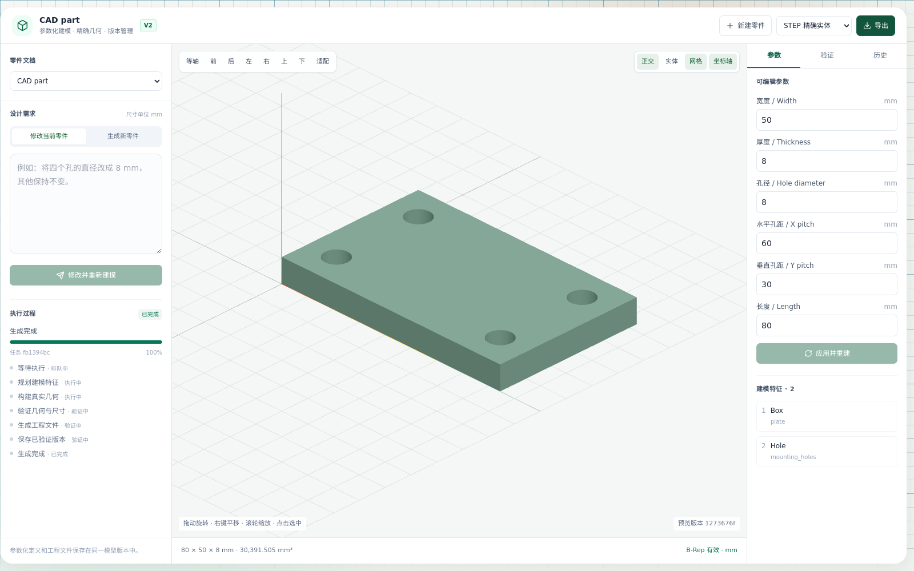
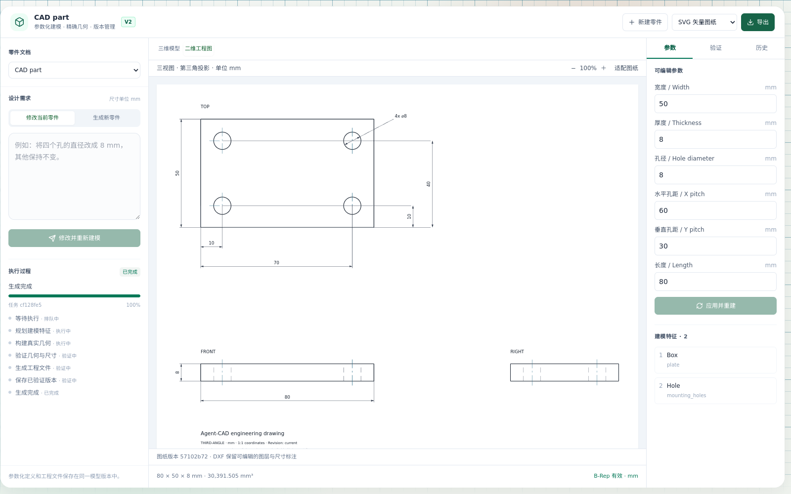
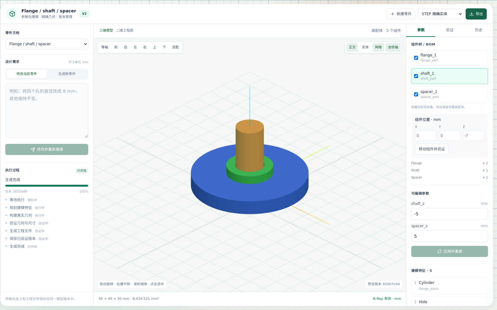
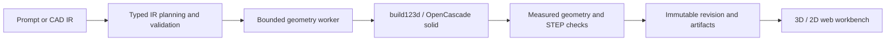

# Agent-CAD

**Open-source AI CAD agent for natural-language 3D modeling, parametric design, and editable 2D engineering drawings.**

[](LICENSE)
[](backend/requirements-cad-v2.txt)
[](backend/requirements-cad-v2.txt)
[](frontend/package.json)

[中文 README](README_zh.md) · [Quick Start](#quick-start) · [Capabilities](#capabilities) · [File Formats](#file-formats) · [FAQ](#frequently-asked-questions) · [Documentation](#documentation)

## What Is Agent-CAD?

Agent-CAD is an open-source AI CAD application that turns mechanical design requirements into parametric 3D solids and editable 2D drawings. It uses **build123d and OpenCascade** for exact boundary-representation (B-Rep) modeling, checks measured geometry and STEP round trips, and publishes **STEP, STL, GLB, DXF, SVG, CAD IR, and replay Python** files tied to the same revision.

Agent-CAD combines text-to-CAD generation, conversational feature edits, a browser-based 3D/2D workbench, and traceable design revisions. The Chinese interface also uses the name **CAD大王**. Engineers, developers, and researchers can run the dedicated CAD workbench locally or integrate CAD tools with the full AgentScope application.

| Project Fact | Current Implementation |
|---|---|
| Software | Agent-CAD, an open-source AI CAD agent and web workbench |
| Source repository | [Jane-o-O-o-O/Agent-CAD on GitHub](https://github.com/Jane-o-O-o-O/Agent-CAD) |
| License | MIT; model providers and external services have their own terms |
| Geometry engine | build123d 0.11.1 / OpenCascade, with measured solid validation |
| Primary workflows | Parametric mechanical parts, feature edits, engineering drawings, named-component assemblies |
| Model access | Configurable OpenAI-compatible endpoint; explicit IR and supported offline prompts need no model key |
| Standalone storage | Local SQLite and revision artifacts; one API supervisor per store |
| Deployment | Linux for the default strict worker; Docker or local Python 3.12 |

## See the Workbench



<details>
<summary>2D engineering drawings and assembly workspace</summary>





</details>

These are captured application views. Inspect actual sample files: [mounting-plate DXF](docs/refactor/assets/extension/mounting-plate-8.dxf), [SVG drawing](docs/refactor/assets/extension/mounting-plate-8.svg), [assembly STEP](docs/refactor/assets/extension/assembly.step), and [BOM CSV](docs/refactor/assets/extension/assembly-bom.csv).

## Capabilities

| Workflow | What Agent-CAD Does | Scope |
|---|---|---|
| Natural-language CAD generation | Converts supported explicit prompts or model-planned requirements into typed CAD IR and real solids | Unclear requirements can trigger clarification; arbitrary prompts are not guaranteed |
| Parametric mechanical modeling | Builds primitives and supported sketches, holes, extrusions, booleans, patterns, fillets, and other declared features | Feature support is defined in the [CAD IR specification](docs/refactor/cad-ir-spec.md) |
| Conversational editing | Plans atomic patches to parameters and features, including scoped hole edits and placement changes | Preserves unrequested design intent; rejected edits retain the last valid revision |
| Geometry validation | Checks topology, dimensions, volume, declared constraints, and exported STEP after reimport | Unverified constraints block publication; validation is not engineering certification |
| 2D engineering drawings | Derives third-angle views, visible/hidden geometry, centerlines, and supported dimensions from the final B-Rep | DXF for editable geometry; SVG for preview; no general GD&T or section-view automation |
| Assemblies and BOM | Supports reusable part definitions, named instances, explicit poses, collision checks, component selection/hiding/moving, and BOM exports | Checks supplied fixed/aligned/concentric placements; no general assembly constraint solver |
| Revisions and delivery | Keeps immutable revision files, validation reports, history, and restore-as-new-revision workflows | A preview and its downloads refer to the same revision |
| Document-assisted 2D drafting | The full AgentScope application reads reference documents, uses structured DXF tools, and streams task progress | Requires the integrated application's services; extraction quality depends on input and parser |

Typical uses include mounting plates, brackets, flanges, hole patterns, slots, parameter studies, and document-assisted engineering drawings. Agent-CAD supports CAD automation through a web interface and authenticated APIs; generated designs still require the engineering review appropriate to their use.

### File Formats

| Format | Agent-CAD Output | Intended Use |
|---|---|---|
| STEP | Exact solid geometry; assembly component identities and placements | CAD interchange and independent geometry inspection |
| STL | Tessellated mesh | Mesh-based fabrication workflows after checking units and process requirements |
| GLB | 3D preview; assembly hierarchy, colors, and component identifiers | Browser visualization; not a replacement for exact STEP geometry |
| DXF | Editable 2D projected geometry and supported dimensions | Engineering drawing exchange with DXF-capable CAD software |
| SVG | 2D projected drawing preview | Browser viewing and documentation |
| CAD IR / JSON | Versioned parameters, features, dependencies, constraints, and design expectations | Reproducible parametric definitions and API integration |
| Python | Trusted replay program plus the design IR | Rebuild and validate using the installed Agent-CAD runtime |
| BOM JSON / CSV | Assembly part quantities and component information | Parts lists and downstream processing; available for assemblies |

Each new V2 revision includes seven core artifacts: STEP, STL, GLB, DXF, SVG, IR, and Python. Assemblies add BOM outputs. Older revisions are not rewritten to add missing artifacts.

Agent-CAD does not author native DWG or automatically turn arbitrary DXF, STEP, or scanned drawings into a parametric 3D model. The full application's document intake is separate from V2 geometry generation; some CAD inputs provide only metadata or require external parsers/conversion. STEP reimport checks generated files, rather than providing a general CAD import editor.

## Generate and Edit a Mechanical Part

The following fully specified Chinese prompt matches the supported offline mounting-plate parser and needs no model API key:

```text
生成一块长 80 mm、宽 50 mm、厚 8 mm 的安装板，在四角开四个直径 6 mm 的通孔，孔中心的水平距离为 60 mm，垂直距离为 30 mm。
```

After generation, submit an incremental edit:

```text
将左边两个孔的直径改成8mm，并将右边两个孔向左移动5mm，其他保持不变。
```

The workbench publishes a new revision after rebuilding and validation. Previous STEP files remain available in history. For broader natural-language requests, configure a compatible model endpoint; explicit CAD IR can run entirely without a language model. Supported offline grammar is narrower than general text-to-CAD understanding.

## Quick Start

### Choose a Runtime

| Mode | Best For | Dependencies |
|---|---|---|
| **Standalone CAD V2** | 3D/2D workbench, exact geometry, revisions, and CAD APIs | CAD runtime, local persistent storage, private local token; no MongoDB, Redis, or browser sandbox |
| **Full application** | AgentScope chat, reference-file intake, original 2D DXF workflow, and optional OpenClaw integration | Backend, frontend, MongoDB, Redis, sandbox, and relevant optional services |

The default `strict` CAD worker requires **Linux with Landlock ABI >= 3 and libseccomp2**. Unsupported hosts reject geometry jobs. Docker uses the host kernel, so containerization alone does not supply missing Landlock support. The checked cloud environment used Linux x86_64; this README does not claim native Windows/macOS strict-worker support.

Clone the repository:

```bash
git clone https://github.com/Jane-o-O-o-O/Agent-CAD.git
cd Agent-CAD
```

### Option A: Standalone Docker

Use Docker and Docker Compose on a supported Linux host. Set your own private ASCII token of at least 16 characters:

```bash
export CAD_V2_LOCAL_TOKEN='replace-with-your-own-private-token-at-least-16-characters'
docker compose -f docker-compose.cad-v2.yml up -d --build
```

Open **<http://127.0.0.1:5173/chat/cad-v2>**. Log in with **`local@localhost`**, using your `CAD_V2_LOCAL_TOKEN` as the password. `CAD_V2_PORT` changes the frontend port. The `cad_v2_data` volume preserves the database and revision files; keep this volume when updating.

### Option B: Local Development

Use Linux, Python 3.12, [uv](https://docs.astral.sh/uv/), and Node.js 24. Install the native libraries used by the CAD runtime; on Debian/Ubuntu:

```bash
sudo apt-get update
sudo apt-get install -y libexpat1 libgl1 libseccomp2 libx11-6
```

From the repository root, start the backend:

```bash
cd backend
uv venv .venv-cad --python 3.12
uv pip sync --python .venv-cad/bin/python requirements-cad-v2.txt
export CAD_V2_LOCAL_TOKEN='replace-with-your-own-private-token-at-least-16-characters'
export CAD_V2_DATA_DIR="$PWD/.cad-v2-data"
.venv-cad/bin/python -m uvicorn app.interfaces.cad_v2_app:app --host 127.0.0.1 --port 8000 --workers 1
```

In a second terminal, from the repository root:

```bash
cd frontend
npm ci
BACKEND_URL=http://127.0.0.1:8000 npm run dev -- --host 127.0.0.1
```

Open the same workbench URL and use the local login above. For explicitly trusted local development on a host without strict isolation, `CAD_V2_ISOLATION=process-dev` opts into process/resource limits without filesystem or network confinement. This mode is not a substitute for strict deployment isolation.

### Optional Model Configuration

Set these environment variables before starting the backend, or before invoking standalone Docker Compose:

```bash
export CAD_V2_API_BASE='https://api.openai.com/v1'
export CAD_V2_API_KEY='replace-with-your-provider-key'
export CAD_V2_MODEL='replace-with-a-compatible-model-id'
```

Agent-CAD's model gateway uses an OpenAI-compatible chat endpoint with JSON-object responses and local schema validation. The code's default model ID is `gpt-6.1-sol`; choose an ID actually available from your configured provider. API usage may incur provider charges. See [the CAD environment example](backend/.env.cad-v2.example); it is a configuration reference, so local launches require exporting the values rather than merely copying the file.

### Optional Full Application

From the repository root:

```bash
cp .env.example .env
# Configure API_KEY, API_BASE, MODEL_NAME, authentication, and service settings.
bash dev.sh up -d --build
```

Open <http://localhost:5173>; the integrated backend runs at <http://localhost:8000>. `AUTH_PROVIDER=none` is available for local mock development. The model simulator can use `API_BASE=http://mockserver:8090/v1` with a nonempty test key; canned responses do not measure CAD planning quality. See [full-stack configuration](docs/configuration.md) and [deployment/migration guidance](docs/refactor/migration-guide.md).

## Architecture and APIs



The language model proposes structured design data. A trusted compiler and geometry backend own modeling, validation, and publication. Agent-CAD does not execute arbitrary Python supplied by the model. Jobs expose persisted progress events through SSE, and revision-bound downloads preserve the relationship between design parameters and exported geometry.

| Layer | Technology |
|---|---|
| Exact CAD | build123d, OpenCascade/OCP, CAD IR schema 2.0 |
| Drawings and visualization | ezdxf, Three.js, dxf-viewer, OpenCascade hidden-line removal |
| CAD API and revision store | Python 3.12, FastAPI, Pydantic, SQLite, local artifact storage |
| Web interface | Vue 3, TypeScript, Vite, Tailwind CSS |
| Full application | AgentScope 2.0, document parsers, MongoDB, Redis, Docker sandbox, optional OpenClaw |

`/api/v1/cad-v2/*` exposes generation jobs, status/SSE, documents, edits, revisions, restore, and artifact downloads. The integrated application also retains `/api/v1/cad/*` for its original 2D workflow. Read the [API contract](docs/refactor/api-v2.md) before integrating: HTTP 202 means submitted, and a published revision requires a completed job with passed validation.

Deploy **one API supervisor per local data store**. Multiple workers/replicas or SQLite on NFS are unsupported. Back up the whole `CAD_V2_DATA_DIR`, including SQLite and artifacts, and retain the service-visible data path when restoring. The standalone local-token mode represents one user; integrated deployments use the application's authentication.

## Recorded Validation and Current Limits

The [2026-10-14 extension report](docs/refactor/extension-report.md) records the latest cloud checks and their scope:

| Recorded Check | Result | What It Establishes |
|---|---|---|
| Fixed CAD IR corpus | **30/30** | 20 basic and 10 medium reviewed designs pass real-kernel build, geometry/constraint checks, and STEP export/reimport |
| Backend regression suite | **226 passed, 1 skipped** | Recorded cloud tests; the skipped case depends on Landlock being unavailable |
| Frontend and browser | **9 frontend tests; 13/13 browser scenarios** | Type/build checks and implemented create/edit/drawing/assembly/revision/download workflows |
| Standalone CAD Docker | **3 revisions, 7 exports each; 21 unchanged hashes after restart** | Recorded strict isolation and persistent revision delivery |
| Full development Docker stack | Internal probes passed; final rerun was not awaited | Does not establish a completed full-stack CI pass or production deployment |

The **30/30 result is a fixed IR geometry benchmark, not a natural-language success rate**. A separate real-model editing example has independent checks, but one example does not establish general model reliability. Historical counts describe recorded runs, rather than checks rerun for every README edit. See the [benchmark methodology and raw evidence](docs/refactor/benchmark-report.md).

Current limits include native DWG authoring, automatic arbitrary drawing-to-3D conversion, general free-form modeling, general assembly constraint solving, complete manufacturing drawings/GD&T, and distributed CAD workers. Geometry recovery uses bounded supported strategies and must still pass the original constraints. Engineering standards certification and unattended design correctness are not claimed.

## Frequently Asked Questions

### What is Agent-CAD used for?

Agent-CAD automates supported mechanical CAD tasks: natural-language or IR-based part generation, parametric edits, exact solid checks, editable engineering drawing export, assembly inspection, and revision history. The full application additionally supports document-assisted 2D drafting.

### Is Agent-CAD free and open source?

Agent-CAD is available under the MIT License and can be self-hosted. Running costs depend on your hardware and any model APIs or external services you choose; the repository license does not make those services free.

### Can Agent-CAD work offline without an AI API key?

Agent-CAD can execute explicit CAD IR and its supported deterministic prompt/edit grammar without a model key, once dependencies are installed. General natural-language planning requires a configured model endpoint, which can be local if it satisfies the API and response requirements.

### Can Agent-CAD generate both 3D models and 2D CAD drawings?

Agent-CAD V2 creates exact B-Rep solids and derives 2D engineering views from the final geometry. It exports STEP/STL/GLB for 3D uses and DXF/SVG for drawings; the full application also retains its separate 2D DXF workflow.

### Does Agent-CAD replace AutoCAD or support DWG?

Agent-CAD is a standalone web application, not an AutoCAD plugin or a full replacement for a desktop CAD system. It produces DXF for DXF-capable applications and STEP for CAD interchange. Native DWG authoring is unsupported; engineering input requiring DWG needs an external conversion workflow.

### Does Agent-CAD support assemblies?

Agent-CAD supports named component instances, explicit placement, geometric collision checks, STEP/GLB component exports, and BOM JSON/CSV. Its supported placement constraints check supplied positions; Agent-CAD does not provide a general assembly constraint solver.

### Can Agent-CAD run privately on my own machine?

Agent-CAD can run locally or on your own Linux host. Standalone CAD needs no MongoDB, Redis, or browser sandbox. Design data persists locally; when you configure a remote model provider, the prompts and design context supplied to that provider leave the host.

### Can I run Agent-CAD on Windows or macOS?

Agent-CAD's default strict CAD worker targets Linux with Landlock ABI >= 3 and libseccomp2. Use a compatible Linux environment and verify its kernel capabilities. A Linux container on Windows/macOS still depends on its VM kernel; this repository does not establish native strict-worker support on those platforms.

## Documentation

| Guide | Contents |
|---|---|
| [V2 architecture](docs/refactor/architecture-v2.md) | Domain boundaries, exact geometry backend, worker execution, and revision storage |
| [CAD IR specification](docs/refactor/cad-ir-spec.md) | Parameters, feature types, dependencies, constraints, assemblies, and replay |
| [API reference](docs/refactor/api-v2.md) | Job submission, events, edits, revisions, authentication, and downloads |
| [Agent workflow](docs/refactor/agent-workflow.md) | Planning, incremental edits, clarification, repair, and publication |
| [Geometry validation](docs/refactor/geometry-validation.md) | Measurements, supported engineering checks, and failure handling |
| [Benchmark report](docs/refactor/benchmark-report.md) | Fixed corpus, methodology, results, and live-model spot checks |
| [Extension and cloud report](docs/refactor/extension-report.md) | Latest drawing/assembly features, browser evidence, and Docker validation |
| [Migration guide](docs/refactor/migration-guide.md) | Standalone vs integrated deployment, configuration, persistence, and client migration |
| [Full-stack configuration](docs/configuration.md) | Application, sandbox, model, authentication, and optional service settings |

Older reports preserve their original test environment. For the updated cloud/Docker status, use the dated extension report above.

## Development and Contributions

```text
Agent-CAD/
├── frontend/                # Vue web workbench, Three.js and DXF viewers
├── backend/                 # CAD domain, compiler, kernel adapter, APIs, agents
├── sandbox/                 # Full-application shell, file and browser runtime
├── claw/                    # Optional OpenClaw integration
├── data_processor_service/  # Optional reference-document processing
├── mockserver/              # Development model-response simulator
├── scripts/                 # CAD and full-stack deployment probes
└── docs/                    # Specifications, benchmarks and recorded evidence
```

Report reproducible issues or propose focused changes through [GitHub Issues](https://github.com/Jane-o-O-o-O/Agent-CAD/issues) and [pull requests](https://github.com/Jane-o-O-o-O/Agent-CAD/pulls). For geometry bugs, include units, prompt or redacted IR, failing feature, validation diagnostics, and runtime/isolation mode. Keep credentials and private engineering files out of public reports.

Frontend checks, from `frontend/`:

```bash
npm test
npm run type-check
npm run build
```

Backend CAD checks, from `backend/`, using a CAD environment with the additional test dependencies listed in the [CI workflow](.github/workflows/cad-v2.yml):

```bash
python -m pytest tests/cad_v2 tests/test_agentscope_runtime.py tests/test_skills.py -q
python -m benchmarks.cad_v2.run --output /tmp/cad-v2-benchmark
```

For container validation, see [the CAD smoke script](scripts/smoke_cad_v2_docker.sh) and [the full-stack smoke script](scripts/smoke_full_stack_docker.sh). Tests for the full application's HTTP/sandbox APIs require their running services.

## License and Acknowledgements

Agent-CAD is distributed under the [MIT License](LICENSE). Required copyright notices remain in the license. The project uses build123d, OpenCascade, AgentScope, ezdxf, Three.js, Docling, FastAPI, Vue, and other open-source libraries; dependency licenses remain applicable.
