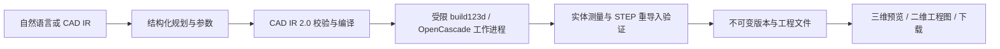

# Agent-CAD

**Agent-CAD（CAD大王）是一个开源 AI CAD 智能体，将自然语言设计需求转化为可编辑、可验证的参数化三维模型和二维工程图。** 它使用 CAD IR 2.0 描述设计意图，通过 build123d / OpenCascade 构建真实实体，交付 STEP、STL、GLB、DXF、SVG 和可重放的建模文件。独立 V2 工作台适合三维机械零件与明确位姿的装配体，完整 AgentScope 应用提供二维 DXF 制图、会话和工程资料解析工作流。

[English](README.md) · **简体中文** · [快速开始](#快速开始) · [API 文档](docs/refactor/api-v2.md)

[](LICENSE)
[](backend/pyproject.toml)
[](backend/app/infrastructure/cad_v2/backend.py)
[](frontend/package.json)

| 项目事实 | 内容 |
|---|---|
| 项目名称 | Agent-CAD；中文助手名称：CAD大王 |
| 代码仓库 | [Jane-o-O-o-O/Agent-CAD](https://github.com/Jane-o-O-o-O/Agent-CAD) |
| 部署方式 | Linux 本地或 Docker 自托管；独立 V2 与完整 AgentScope 应用 |
| 开源许可 | [MIT](LICENSE) |

## 目录

- [工作台预览](#工作台预览)
- [能力与使用场景](#能力与使用场景)
- [支持的文件格式](#支持的文件格式)
- [生成与编辑示例](#生成与编辑示例)
- [快速开始](#快速开始)
- [架构与技术栈](#架构与技术栈)
- [配置与数据管理](#配置与数据管理)
- [验证证据与能力边界](#验证证据与能力边界)
- [常见问题](#常见问题)
- [文档与贡献](#文档与贡献)
- [开源许可](#开源许可)

## 工作台预览

真实工作台截图及对应文件来自仓库中的验收记录。

### 参数化三维模型


### 二维工程图


### 装配体与组件树


可直接查看示例 [STEP 零件](docs/refactor/assets/mounting-plate-8.step)、[DXF 工程图](docs/refactor/assets/extension/mounting-plate-8.dxf)、[SVG 三视图](docs/refactor/assets/extension/mounting-plate-8.svg)、[装配 STEP](docs/refactor/assets/extension/assembly.step) 和 [BOM 清单](docs/refactor/assets/extension/assembly-bom.csv)。

## 能力与使用场景

Agent-CAD 提供两条互补的工作流；独立 V2 无需启动 MongoDB、Redis 或浏览器沙箱。

| 能力 | 独立 V2 精确 CAD 工作台 | 完整 AgentScope 应用 | 典型用途 |
|---|---|---|---|
| 自然语言三维建模 | 结构化规划、CAD IR、真实 B-Rep 实体与 STEP 验证 | 通过 CAD V2 工具调用同一服务 | 安装板、法兰、支架、孔槽与旋转零件 |
| 参数化建模与编辑 | 参数、特征增量补丁、自然语言编辑、澄清续答 | 可在会话中提交生成与编辑任务 | 改孔径、移动孔、增加槽、调整尺寸 |
| 历史版本 | 不可变版本、精确版本预览、恢复后重新验证 | V2 使用相同版本存储 | 对比方案、回退设计、追溯交付 |
| 二维工程图 | 从最终实体生成第三角三视图、尺寸、DXF / SVG | 保留独立二维 DXF 绘图工具与画布 | 零件视图、中心线、尺寸和图层 |
| 装配体 | 共享零件定义、命名实例、位姿编辑、组件显隐、碰撞检查与 BOM | 可调用 V2 装配工作流 | 小型组件组合与物料清单 |
| 工程资料输入 | 直接提交设计需求或 CAD IR | 文件上传、格式解析、来源与不确定项记录 | PDF / Word / 表格中的制图需求 |
| 任务执行 | 严格受限几何子进程、队列、进度、取消与超时 | 增加 AgentScope ReAct、沙箱、可选 Claw 集成 | 自动化任务与工具编排 |

装配检查核验明确给定的位姿和实体交叠；工程图输出保留可编辑曲线与尺寸实体。高级约束求解和完整制造图审签的范围见[能力边界](#验证证据与能力边界)。

## 支持的文件格式

| 格式 | 支持方式 | 说明 |
|---|---|---|
| CAD IR 2.0 / JSON | V2 输入与导出 | 保存参数、特征、约束、设计预期与装配定义；可离线执行 |
| STEP / STP | V2 STEP 导出与重导入验证 | 精确三维实体；装配导出保留组件身份，支持后续 CAD 工具交换 |
| STL | V2 导出 | 三角网格，用于查看或下游打印准备；需自行检查制造适用性 |
| GLB | V2 导出与浏览器预览 | 网格、颜色和装配组件身份；精确几何以 STEP / B-Rep 为准 |
| DXF | V2 工程图导出；完整应用二维绘图与校验 | V2 含原生曲线与 DIMENSION；二维工具支持 R2010 / R2018 |
| SVG | V2 工程图导出与预览 | 便于浏览器查看三视图；部分曲线使用采样表示 |
| Python | V2 建模重放文件导出 | 可信 IR 重建与验证程序；需要项目 CAD 运行依赖 |
| BOM JSON / CSV | V2 装配体导出 | 组件与物料清单；单零件无需装配 BOM |
| PDF / DOCX / XLSX / 图片 / 文本 / ZIP | 完整应用工程资料输入 | 按解析器与配置提取证据；Docling 可选，ZIP 为文件列表解析 |
| DWG / DOC / XLS / IGES / 既有三维文件 | 有限识别或需外部转换、解析器 | DWG 不支持原生导出；CAD 文件识别不等于几何导入或自动逆向建模 |

目前工程资料解析中的 DXF 读取为有限文本提取，STEP / IGES / STL 输入主要记录文件元信息。V2 的 STEP 重导入用于验证自身导出结果，不构成任意外部模型导入编辑功能；任意 DXF 转参数化三维模型尚未实现。

## 生成与编辑示例

### 生成带四个通孔的安装板

以下尺寸明确的安装板请求使用内置离线解析路径，无需模型 API Key：

```text
生成一块长 80 mm、宽 50 mm、厚 8 mm 的安装板，在四角开四个直径 6 mm 的通孔，孔中心的水平距离为 60 mm，垂直距离为 30 mm。
```

生成后，可继续输入：

```text
将四个孔的直径改成 8 mm，其他保持不变。
```

Agent-CAD 对当前版本应用增量修改，重新构建并检查几何，通过后发布新版本。预览、STEP、工程图和其他下载绑定同一版本；失败时保留上一个有效版本。

### 组合自然语言编辑

配置模型后，可以表达增加特征和保留条件，例如：

```text
将现有直径 6 mm 的孔移动到 (20, 10)，在 (35, 20) 增加一个 10 mm × 8 mm 的矩形通槽。保留板的外形尺寸和厚度。
```

此类编辑的[真实模型验收记录](docs/refactor/assets/extension/live-edit/report.json)包含独立 STEP 检查；示例只说明这一用例，不代表任意描述都会成功。信息不足时，工作台会请求补充条件；复杂三维创建和编辑需要兼容的模型服务或完整 CAD IR。

### 通过 API 提交任务

以下示例针对本地开发后端的 `8000` 端口。独立 Docker 方案默认不发布 API 端口，外部请求应通过 `http://127.0.0.1:5173/api/v1/cad-v2/jobs` 的前端反向代理访问。

```bash
curl http://127.0.0.1:8000/api/v1/cad-v2/jobs \
  -H "Authorization: Bearer $CAD_V2_LOCAL_TOKEN" \
  -H 'Content-Type: application/json' \
  -d '{"prompt":"生成一块长 80 mm、宽 50 mm、厚 8 mm 的安装板，在四角开四个直径 6 mm 的通孔，孔中心的水平距离为 60 mm，垂直距离为 30 mm。","request_id":"first-plate"}'
```

HTTP `202` 表示任务已提交。查询返回的任务 ID 或订阅 SSE，只有状态为 `completed`、发布了 revision 且验证通过，才表示建模完成。详见 [V2 API](docs/refactor/api-v2.md)。

## 快速开始

### 推荐：独立 V2 本地运行

使用 Linux、Python 3.12、[uv](https://docs.astral.sh/uv/) 与 Node.js / npm；已记录的开发环境使用 Node.js 24。默认几何执行要求 **Landlock ABI >= 3 和 libseccomp2**，并需要 CAD 内核对应的 OpenGL / X11 / Expat 运行库（见 [Dockerfile](backend/Dockerfile.cad-v2)）。Windows 用户可使用满足这些要求的 Linux / WSL2 环境；原生 Windows 几何执行尚未实现。

Debian / Ubuntu 运行库可安装为：

```bash
sudo apt-get update
sudo apt-get install -y libexpat1 libgl1 libseccomp2 libx11-6
```

获取代码：

```bash
git clone https://github.com/Jane-o-O-o-O/Agent-CAD.git
cd Agent-CAD
```

在后端终端运行，先将示例 token 替换为自己保管的、至少 16 字符的私密 ASCII token：

```bash
cd backend
uv venv .venv-cad-v2 --python 3.12
uv pip sync --python .venv-cad-v2/bin/python requirements-cad-v2.txt
export CAD_V2_LOCAL_TOKEN='replace-with-your-private-ascii-token'
export CAD_V2_DATA_DIR="$PWD/.cad-v2-data"
.venv-cad-v2/bin/python -m uvicorn app.interfaces.cad_v2_app:app --host 127.0.0.1 --port 8000 --workers 1
```

另开前端终端，从仓库根目录运行：

```bash
cd frontend
npm ci
BACKEND_URL=http://127.0.0.1:8000 npm run dev -- --host 127.0.0.1
```

打开 <http://127.0.0.1:5173/chat/cad-v2>。登录邮箱为 `local@localhost`，密码为设置的 `CAD_V2_LOCAL_TOKEN`。这是单用户本地身份；更换 token 才会撤销该凭据，浏览器退出登录仅清除客户端登录状态。

若宿主无法提供严格隔离，几何任务会以 `IsolationUnavailableError` 拒绝执行。可信本地开发可在启动后端前**明确设置** `CAD_V2_ISOLATION=process-dev`；该模式保留进程与资源限制，但没有文件系统和网络访问隔离，实际模式会记录在执行报告中。

### 可选：独立 V2 Docker 部署

在支持 Landlock 的 Linux Docker 主机上，从仓库根目录运行：

```bash
export CAD_V2_LOCAL_TOKEN='replace-with-your-private-ascii-token'
docker compose -f docker-compose.cad-v2.yml up -d --build
```

入口和登录方式与上文一致。前端默认只绑定 `127.0.0.1:5173`，可用 `CAD_V2_PORT` 修改端口；API 在 Compose 内部访问。`cad_v2_data` 命名卷保存 SQLite 与工件；该 Compose 固定使用 `strict`，镜像内提供所需运行库，宿主内核仍需支持 Landlock。

### 可选：完整 AgentScope 开发栈

需要会话、工程资料解析和独立二维 DXF 工作流时，使用完整开发栈。以下是仅供本地开发的 mock 模型配置：

```bash
cp .env.example .env
```

在 `.env` 中设置：

```ini
AUTH_PROVIDER=none
API_KEY=test
API_BASE=http://mockserver:8090/v1
```

```bash
./dev.sh up -d --build
```

打开 <http://localhost:5173>。mockserver 用于开发模拟，真实 CAD 推理需换为可用的 OpenAI 兼容模型，并配置 `API_BASE`、`API_KEY` 和 `MODEL_NAME`。完整栈使用 MongoDB、Redis 和 sandbox，并可接入 data-processor；V2 几何执行继续遵循自身隔离要求。

## 架构与技术栈



语言模型负责理解设计意图，可信编译器与 CAD 内核负责几何执行。工作进程只解释经过校验的 IR，不执行模型生成的 Python；下载的 Python 用于重放同一设计。

| 层级 | 技术与职责 |
|---|---|
| 三维 CAD | CAD IR 2.0、build123d、OpenCascade / OCP、真实几何与约束检查 |
| 二维 CAD | OpenCascade HLR 三视图、ezdxf、SVG、完整应用二维绘图工具 |
| 智能体与模型 | AgentScope 2.0 ReAct、结构化规划和编辑、OpenAI 兼容接口 |
| 后端与数据 | Python 3.12、FastAPI、Pydantic v2；V2 使用 SQLite，完整应用使用 MongoDB / Redis |
| 前端 | Vue 3、TypeScript、Vite、Three.js、dxf-viewer、Tailwind CSS |
| 执行与解析 | Landlock / seccomp、Docker 沙箱、格式专用解析器、可选 Docling 与 Claw |

核心实现位于 `backend/app/domain/cad_v2/`、`backend/app/application/services/cad_v2_*`、`backend/app/infrastructure/cad_v2/` 和 `frontend/src/pages/CADV2Page.vue`。完整说明见 [V2 架构](docs/refactor/architecture-v2.md) 和 [CAD IR 规范](docs/refactor/cad-ir-spec.md)。

## 配置与数据管理

| 配置 | 用途 |
|---|---|
| `CAD_V2_LOCAL_TOKEN` | 独立工作台私密登录 / Bearer token，至少 16 字符 |
| `CAD_V2_DATA_DIR` | SQLite、任务记录、版本与工件的本地持久目录 |
| `CAD_V2_ISOLATION` | 默认 `strict`；`process-dev` 仅供明确选择的可信开发 |
| `CAD_V2_API_BASE` / `CAD_V2_API_KEY` | 可选 OpenAI 兼容模型服务；可回退到 `API_BASE` / `API_KEY` |
| `CAD_V2_MODEL` | 通用模型；回退到 `MODEL_NAME`，最终默认 `gpt-6.1-sol` |
| `CAD_V2_PLANNER_MODEL` / `CAD_V2_EDITOR_MODEL` | 可选规划 / 编辑模型覆盖 |
| `CAD_V2_MAX_CONCURRENCY` / `CAD_V2_MAX_QUEUE` | 默认 2 个并发几何任务 / 32 个任务准入额度 |
| `CAD_V2_TIMEOUT_SECONDS` | 默认 90 秒几何执行时限 |

完整示例见 [V2 环境变量](backend/.env.cad-v2.example) 和[完整应用配置](.env.example)。V2 环境示例是配置参考，独立服务不会自动读取该文件，本地启动需显式 `export`。复杂请求可配置模型，模型 ID 以所选服务实际可用的名称为准；明确支持的离线语法和完整 IR 不需要模型密钥。密钥只注入服务环境，不应进入提交、截图或导出文件。

每个 V2 数据目录只允许**一个 API supervisor（`uvicorn --workers 1`）**，不支持多副本共享 SQLite 或将数据库放在 NFS。备份前应正常停止 supervisor，保存整个数据目录（数据库及辅助文件、`artifacts/`），并记录代码版本与服务可见的绝对路径。详见[迁移与备份指南](docs/refactor/migration-guide.md)。

## 验证证据与能力边界

以下结果来自 [2026-10-14 扩展交付报告](docs/refactor/extension-report.md)及其 [GitHub Actions 记录](https://github.com/Jane-o-O-o-O/Agent-CAD/actions/runs/38524550093)，属于已记录的运行结果，并非本次 README 编辑重新执行的检查：

| 检查 | 记录结果 | 含义 |
|---|---|---|
| 后端回归 | 226 passed，1 skipped | 包含真实严格文件 / 网络拒绝检查；跳过主机不支持 Landlock 的环境条件用例 |
| 固定 IR 几何基准 | 30/30 | 20 个基础与 10 个中等、固定 IR 设计通过真实内核检查；**不是自然语言成功率** |
| 前端与浏览器 | 9 项测试、类型检查、构建、13/13 浏览器场景通过 | 包含工程图、下载、历史恢复、自然语言编辑和装配操作 |
| 独立 CAD Docker | 3 个版本 × 7 种导出，重启后 21 个哈希一致 | 验证严格隔离与持久化；不等于已部署生产 |
| 完整七服务栈 | 内部检查通过，最终修复后的 CI 重跑结果未等待 | 尚不能标记完整全栈 CI 验收通过，也不代表真实聊天工具链验收 |

当前边界：

- **自然语言**：内置离线创建语法范围有限；模型生成仍需通过 IR、设计保留规则与真实几何验证，不保证任意需求成功。
- **装配**：支持命名实例、位姿、BOM 和实体碰撞检查；`fixed` / `aligned` / `concentric` 核验给定位置，不提供通用装配约束求解。
- **工程图**：支持第三角三视图、可见 / 隐藏线、中心线与实测尺寸；通用剖视、GD&T、制造图自动审签和任意布局优化尚未实现。
- **修复与几何**：实现有限、可追溯的 OCCT 修复；不能修复任意损坏模型，复杂自由曲面和部分约束仍受支持范围限制，未验证条件会阻止发布。
- **工程责任**：几何验证不等于强度、材料、工艺或行业标准认证；生产部署仍需在目标主机验证认证、隔离、备份恢复与网络入口。

细节见[几何验证](docs/refactor/geometry-validation.md)、[基准报告](docs/refactor/benchmark-report.md)与[最新扩展报告](docs/refactor/extension-report.md)；较早文档中的部署状态应结合最新报告阅读。

## 常见问题

### 什么是 Agent-CAD？它和 CAD大王是什么关系？

Agent-CAD 是面向自然语言三维建模和二维工程制图的开源 CAD 智能体；CAD大王是项目中文界面中的助手名称。Agent-CAD 输出可验证的实体与工程文件，并保留参数、版本和设计依据。

### Agent-CAD 免费吗？能用于商业项目吗？

Agent-CAD 使用 MIT 许可证，允许按许可证条款使用、修改和分发，包括商业用途。第三方模型 API、计算资源及依赖的许可和费用需分别考虑。

### Agent-CAD 必须接入大模型吗？

Agent-CAD 的完整 CAD IR 执行和受支持的离线安装板语法无需模型 API Key。更复杂的自然语言创建与编辑需要配置兼容模型；Agent-CAD 不内置本地模型权重。

### Agent-CAD 支持 DWG 或 AutoCAD 吗？

Agent-CAD 可导出供 AutoCAD 等支持相应格式的软件继续使用的 DXF，以及精确三维 STEP。Agent-CAD 不提供原生 DWG 导出或 AutoCAD 插件；DWG 输入需要外部转换，格式交换后的兼容性应在目标软件中检查。

### Agent-CAD 同时支持二维和三维吗？

Agent-CAD 独立 V2 支持参数化三维实体，以及从实体派生的 DXF / SVG 二维工程图。Agent-CAD 完整应用保留独立二维 DXF 工作流；既有二维图纸不会自动转换为参数化三维模型。

### Agent-CAD 能离线使用或私有部署吗？

Agent-CAD 可以在本地主机或私有 Linux 环境部署，独立 V2 不依赖 MongoDB、Redis 和浏览器沙箱。安装运行依赖后，IR 与受支持语法可离线执行；使用外部模型服务时，相应设计内容会发送给该服务，应按部署需求选择模型端点。

### Agent-CAD 支持装配体吗？

Agent-CAD 支持共享零件、命名实例、位姿编辑、组件显隐、真实碰撞检查和 BOM 导出，并在 STEP / GLB 中保留组件身份。Agent-CAD 的装配检查不包含通用约束求解或机构运动仿真。

### Agent-CAD 对硬件和操作系统有什么要求？

Agent-CAD 几何执行使用 Linux CPU，无需本地 GPU；Python 3.12、兼容 CAD 运行库和本地持久磁盘是主要条件。默认 `strict` 要求 Landlock ABI >= 3 与 libseccomp2，原生 Windows 执行未实现；Docker 配置中的 6 GB 内存限制是容器预算，不代表所有模型的最低硬件要求。

## 文档与贡献

| 文档 | 内容 |
|---|---|
| [V2 架构](docs/refactor/architecture-v2.md) | 分层、任务、执行与版本发布 |
| [API](docs/refactor/api-v2.md) / [IR 规范](docs/refactor/cad-ir-spec.md) | 生成、编辑、续答、恢复、下载与设计合同 |
| [迁移指南](docs/refactor/migration-guide.md) | 独立 / 完整部署、配置、备份与恢复 |
| [几何验证](docs/refactor/geometry-validation.md) | 实测几何、约束与修复范围 |
| [基准报告](docs/refactor/benchmark-report.md) / [扩展交付报告](docs/refactor/extension-report.md) | 固定样例、真实文件与当前验收证据 |

欢迎通过 [Issues](https://github.com/Jane-o-O-o-O/Agent-CAD/issues) 报告问题或提出需求，通过 Pull Request 贡献实现。CAD 问题请附最小需求或脱敏 IR、代码版本、隔离模式和验证报告；不要附带 API Key 或私密工程资料。

开发改动应验证受影响的功能。前端可运行 `npm test`、`npm run type-check` 和 `npm run build`；后端 CAD 检查及 Docker 验收入口见 [V2 CI](.github/workflows/cad-v2.yml)。部分完整应用测试依赖运行中的后端、MongoDB、Redis 或 sandbox。

Agent-CAD 使用并感谢 build123d、OpenCascade、AgentScope、ezdxf、Docling、FastAPI、Vue、Three.js 及其他开源依赖。

## 开源许可

Agent-CAD 采用 [MIT License](LICENSE)。使用和分发时请保留许可证要求的版权与许可声明。
