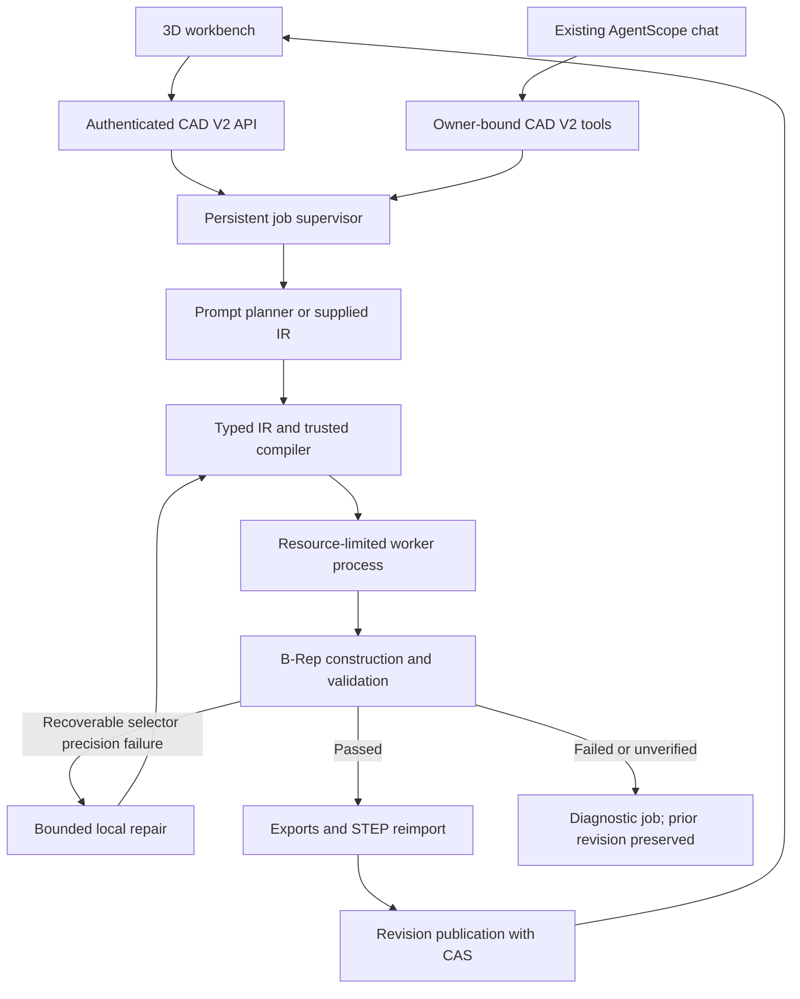

# Agent-CAD V2 architecture

V2 adds a precise 3D path while retaining the existing 2D DXF endpoints. The source of design intent is CAD IR 2.0; build123d/OpenCascade constructs the B-Rep. A completed job must have passed measured geometry validation, STEP reimport, and atomic revision publication. A successful HTTP submission, generated Python file, or visible mesh is not a completed CAD job.

## Execution paths

The worker executes a trusted interpreter over normalized operations. The Python download is a deterministic replay program containing literal IR JSON; neither the model's response nor an uploaded script is executed as Python. Meshes are derived output, not the authoritative solid.

| Layer | Actual implementation | Responsibility |
|---|---|---|
| Domain | `backend/app/domain/cad_v2/models.py`, `expressions.py`, `compiler.py` | Typed feature union, safe arithmetic, dependency graph, unit normalization, static validation and atomic IR patches |
| Domain ports | `domain/cad_v2/contracts.py`, `errors.py` | `CADBackend` build/export/validate/properties/topology/tessellation/cleanup contract and structured errors |
| Application | `application/services/cad_v2_service.py` | Job admission, concurrency, progress, execution, repair, immutable revisions and publication |
| Planning | `application/services/cad_v2_planner.py` | Explicit plate grammar; optional structured model planning; restricted natural-language hole-diameter editing |
| Model adapter | `infrastructure/cad_v2/model_gateway.py` | OpenAI-compatible JSON-object requests, bounded retries/timeouts, usage and call metadata |
| Repair | `application/services/cad_v2_repair.py` | Narrow semantic-selector tolerance adjustment; no design-dimension or validation weakening |
| Geometry | `infrastructure/cad_v2/backend.py`, `validation.py` | build123d/OCP solids, semantic topology selection, actual geometric checks and STEP roundtrip |
| Execution | `infrastructure/cad_v2/executor.py`, `worker.py` | Separate process per attempt, resource limits, progress messages, cancellation, timeout and cleanup |
| Persistence | `infrastructure/cad_v2/store.py` | SQLite documents/revisions/jobs/events, owner filters, supervisor lock and CAS |
| HTTP | `interfaces/api/cad_v2_routes.py` | Request contracts, owner-bound access, SSE and revision-specific downloads |
| Local entry point | `interfaces/cad_v2_app.py` | Standalone bearer-authenticated CAD server, optional built SPA, no Mongo/Redis/browser dependency |
| Chat bridge | `domain/services/tools/cad_v2.py`, `flows/agentscope_flow.py` | Four owner-bound tools using the same lazily acquired service as HTTP |
| Frontend | `frontend/src/pages/CADV2Page.vue`, `frontend/src/components/CAD3DViewer.vue`, `frontend/src/api/cadV2.ts` | Three.js preview, parameters, real job events, revision history and authenticated downloads |

Paths in the table after the first backend row are relative to `backend/app/` unless they start with `frontend/`.

## Compatibility boundary

| Concern | Existing 2D path | V2 3D path |
|---|---|---|
| API | `/api/v1/cad/*` | `/api/v1/cad-v2/*` |
| Design model | `MechanicalCADDocument`, drawing entities | `CADDocumentIR`, parameters and ordered features |
| Geometry | ezdxf lines, arcs, circles, annotations | Exact build123d/OCP B-Rep |
| Persistence | Existing in-process CAD document behavior | Durable jobs and immutable revisions in SQLite |
| Export | DXF | STEP, STL, GLB, IR, Python |
| Execution | Existing workbench and CAD tools | Trusted IR interpreter in a separate process |
| Chat tools | `cad_analyze_request`, `cad_generate_dxf*`, `cad_validate_dxf` | `cad_v2_generate`, `cad_v2_job_status`, `cad_v2_edit`, `cad_v2_revision` |

The V2 tools do not accept a user/owner argument from the model. The authenticated chat flow binds that identity when constructing the toolkit; every job/revision lookup uses it. The system prompt routes 3D/STEP work to V2 and explicit 2D/DXF work to the existing tools. Submission tools explicitly report pending work. Legacy chat still initializes its existing sandbox/browser infrastructure; adding CAD V2 tools does not remove that dependency. The standalone CAD workbench can run without it.

There is no automatic conversion of existing 2D documents or arbitrary DXF files into constrained 3D IR. A new solid needs explicit thickness, modeling intent and feature constraints.

## IR and planning

`CADDocumentIR` version `2.0` records units, a right-handed Z-up coordinate system, parameters, features, input references, dependencies, constraints, expected geometry, and metadata. Parameter expressions are bounded arithmetic, not Python evaluation. The compiler rejects missing references, duplicate IDs, invalid feature order, cycles, zero directions, illegal geometry parameters, excessive patterns and non-finite values. See [CAD IR specification](cad-ir-spec.md).

All coordinates in a document use one of `mm`, `cm`, `m`, or `inch`; normalization produces millimetres and degree angles for the adapter. The narrow deterministic plate parser rejects mixed-unit creation prompts instead of guessing. Explicit IR supports conversion from its one declared document unit. Parameter `kind` controls conversion and integer validation, but the expression evaluator does not implement general dimensional algebra; it cannot prove that arbitrary angle/length expressions are physically compatible.

Offline prompt parsing is intentionally narrow: explicitly dimensioned rectangular plates and the supported centred four-through-hole pattern. It consumes the supported sentence grammar, rather than dropping unrecognized features. Complex shapes require supplied IR or a configured model. The model returns JSON, which must still pass the same local schema and compiler. A model name or key being configured does not establish that a particular provider supports the request format. A live `gpt-6.1-sol` spot check now covers one design through publication and independent STEP checks; the exact failures and follow-up evidence are recorded below. This does not establish a general model success rate.

The gateway reads `CAD_V2_API_BASE`, `CAD_V2_API_KEY`, `CAD_V2_MODEL` and optional role-specific model selection such as `CAD_V2_PLANNER_MODEL`, with existing `API_BASE`, `API_KEY`, `MODEL_NAME` fallbacks. Request timeout and retries are bounded. It logs role, model, attempts, elapsed time and supplied usage counts, not authorization headers or provider error bodies. Planner metadata preserves actual provider usage when available. The current workflow does not invoke separate requirement, repair or vision models gratuitously: those additional multi-model workflows are not implemented.

## Live provider spot check

Three actual model calls exercised a single plate-with-boss-and-through-bore design. The original outcomes remain in the evidence; development fixes and offline rechecks are not counted as new successful model calls.

| Evidence | Actual result |
|---|---|
| [01 — first call](../../backend/benchmarks/cad_v2/live/01-first-model-attempt.json) | Failed compilation because the returned IR referenced `pi` before the compiler supported that constant |
| [02 — second call](../../backend/benchmarks/cad_v2/live/02-second-model-attempt.json) | Produced IR; validation blocked publication because a `solid_count` constraint naming the final output was not yet supported |
| [03 — unchanged IR replay](../../backend/benchmarks/cad_v2/live/03-unchanged-ir-replay.json) | The original second-call IR passed after fixing final-output constraint handling, without another model call |
| [04 — third call and service workflow](../../backend/benchmarks/cad_v2/live/04-final-live-workflow.json) | Model: 35.995 s, reported 19,943 tokens; total run: 41.591 s. The service completed and published all five artifacts, but the independent acceptance runner then raised an `AttributeError` on an empty boolean intersection represented by `None` |
| [05 — independent STEP recheck](../../backend/benchmarks/cad_v2/live/05-independent-step-recheck.json) | After correcting only that checking script, the same published STEP passed 9/9 independent checks. No geometry rebuild and no new model call were used |

Record 04 deliberately retains its outer runner failure even though its nested job and geometry report completed; record 05 supplies the corrected independent verification of that published revision. This demonstrates one design's live planning-to-artifact path and exposes two implementation defects that were fixed. It is neither a multi-design model benchmark nor an estimate of unattended reliability. Deterministic CI remains independent of paid model access. Browser acceptance is reported separately in [final report](final-report.md).

## Jobs and process boundary

Job states are `created`, `queued`, `running`, `validating`, `repairing`, `completed`, `failed`, `cancelled`. Durable snapshots also contain the real stage (`parsing`, `planning`, `building`, `validating`, `exporting`, `publishing`), progress, diagnostic report, repair history and revision ID. Progress percentages indicate stages, not a measured remaining-time estimate.

The service provides bounded queue admission and concurrency. A stable job ID persists across attempts; optional request IDs deduplicate equivalent submissions within owner and operation scope and reject reuse with different content. On restart, queued jobs can resume; work interrupted while actively running is marked failed, because its process and completion cannot be assumed to survive. Temporary job directories are cleaned. A completed or cancelled job cannot later be published again.

Every geometry attempt gets a dedicated process and output directory. The executor passes only a small environment allowlist, excluding model API credentials and proxy settings. The worker limits CPU time, address space, file size and file descriptors, while the parent enforces wall time and kills the process group on cancellation or timeout. No shell is used to interpret model content.

This is **process and resource isolation, not an OS security sandbox**. There are no separate filesystem/network namespaces or seccomp restrictions in this implementation. The worker's OS identity still determines host file and network access. The JSON IR exposes no arbitrary-code or arbitrary-path operation, but untrusted kernel/native-library exploitation is outside this isolation guarantee. Linux/Unix process groups, `resource` and `fcntl` are assumed; equivalent Windows execution has not been implemented.

## Validation and repair

The validator examines the executed solid: validity, positive finite volume, solid count, finite bounds, requested dimensions and volumes, supported hole profiles/positions/diameters/through-clearance or blind depth, and measurable fillet/chamfer material and topology changes. Finish checks also measure supported fillet cylinder/torus radii or planar chamfer-to-original-edge distances and verify those geometric surface signatures remain in the final solid. Post-transform finish matching remains `unverified`. Supported boolean operations reject empty results or ineffective cuts. The exporter writes STEP, reimports it, and compares validity, volume, bounds and solid count. Preview metadata accounts for GLB metre/Y-up presentation versus IR millimetre/Z-up modeling.

Final-output dimension, volume and solid-count constraints are supported both without a `feature_id` and when it explicitly equals the output feature. Each check records expected/actual values, tolerance, status and evidence. Unsupported design constraints are `unverified`, not passed. The worker refuses to publish when any check fails or remains unverified. This conservatism means some buildable complex designs require more supported final-frame constraints or additional geometric verifiers. [Geometry validation](geometry-validation.md) lists exact coverage and limitations.

Automatic repair currently addresses only a reproducible, unique semantic edge selection failing because of overly strict precision in millimetre documents. It can increase that selector's tolerance within a small fixed limit; it preserves dimensions, hole count, required radius, expected match count and all validation expectations. It stores the exact patch and fingerprint, prevents identical retries, and re-runs static and real geometry validation. The default repair budget is three; the configurable budget and local policy have a hard maximum of five attempts. It is not a general CAD healing agent. Infrastructure, invalid dimensions and unverifiable constraints do not become geometry-repair success.

## Persistence and revision publication

V2 uses one local SQLite database in WAL mode because the current service does not need another external queue to execute bounded local jobs. The existing chat task infrastructure depends on Redis and in-process registries, and is not reused as though it were a durable CAD queue. V2 stores documents, immutable revisions, jobs and SSE events together; exported files reside under the same configured data root.

`CAD_V2_DATA_DIR` contains `cad.sqlite3`, SQLite auxiliary files, `supervisor.lock`, temporary `jobs/`, and `artifacts/<document-id>/<revision-id>/`. Artifact records include format, filename, SHA-256 and size. Every published revision contains all five formats. Artifact directories are recorded with absolute paths, so restores must preserve the service-visible data-root path unless a deliberate path migration is implemented.

A nonblocking `fcntl` lock permits exactly one active supervisor per data directory. Run **one API worker** and keep SQLite on local persistent storage. Horizontal replicas, multiple supervisors and SQLite over NFS are not supported. Queue state is durable; this is not a distributed worker system.

Editing uses `expected_revision` as a compare-and-swap precondition. After rebuild and validation, publication starts a SQLite transaction and rechecks the document still points to that base revision and that the job is active. Only then are the immutable revision, current pointer and completed snapshot committed. If another edit won, the result is rejected and unpublished artifacts are removed. A failed edit never replaces the last valid revision.

Parameter patches preserve shared expressions. Feature patches can update params and explicit dependencies/inputs; additions or deletions may require an explicit `output_feature` switch. User-authorized design changes can supply a partial `expected_geometry` patch and a complete replacement `constraints` list. Unspecified expectations remain unchanged. This supports adding/deleting material features while recording the revised engineering intent; automatic repair does not use this escape to weaken checks. Restore rebuilds an old IR into a new revision instead of erasing history.

## HTTP contracts

All paths below have prefix `/api/v1/cad-v2`. Successful JSON responses use the existing `{code: 0, msg: "success", data: ...}` envelope. Creation/edit/restore return HTTP 202 and a job snapshot. Authentication applies to jobs, events, documents, revisions and artifacts; owner mismatches return a not-found result.

| Method and path | Behavior |
|---|---|
| `POST /jobs` | Exactly one `prompt` or `ir`; optional `name`, `request_id` |
| `GET /jobs/{job}` | Current durable status/report |
| `POST /jobs/{job}/cancel` | Cancel pending/running work; preserve published model |
| `GET /jobs/{job}/events` | SSE `job` snapshots with persistent event IDs; resume via `after` or `Last-Event-ID` |
| `GET /documents` | Owner's documents |
| `GET /documents/{document}` | Document and current revision pointer |
| `GET /documents/{document}/revisions` | Immutable history |
| `GET /documents/{document}/revisions/{revision}` | IR, report, diff and artifact manifest for one revision |
| `POST /documents/{document}/edits` | `expected_revision` plus explicit parameter/feature/intent patches or supported edit prompt |
| `POST /documents/{document}/restore` | `revision_id` to restore plus current `expected_revision`; creates a new revision |
| `GET /documents/{document}/revisions/{revision}/artifacts/{format}` | `step`, `stl`, `glb`, `ir`, `python`; authenticated file, ETag and `X-CAD-Revision` |

HTTP schemas reject extra fields and non-finite numeric inputs; request-size middleware bounds V2 JSON requests without changing legacy multipart file upload behavior. Downloads resolve only known manifest files beneath the owned revision directory. Preview and download selection use explicit revision IDs, never a moving “latest” path.

The workbench at `/chat/cad-v2` supports `?document=<id>&revision=<id>` for exact historical views. Parameter changes request a real backend rebuild; camera changes affect viewing only. SSE displays actual service stages, while revision downloads and GLB loading use authenticated requests. Selection is a viewer highlight, not an editable topological index.

## Deployment and evidence boundary

The integrated `app.main:app` retains Mongo/Redis/auth/chat startup and adds the V2 service. The standalone `app.interfaces.cad_v2_app:app` uses a private bearer token of at least 16 characters, exposes the same V2 router, and can serve a built frontend. Login uses `local@localhost` with that private token as the password; compatible login, refresh and logout endpoints support the existing frontend. This fixed token represents one local user and is revoked by rotating the configured token, not by client logout. It is not a multi-user account-management replacement.

The standalone dependency lock is `backend/requirements-cad-v2.txt`; container entry points are `backend/Dockerfile.cad-v2` and `docker-compose.cad-v2.yml`. These describe standalone CAD plus frontend, not the entire original service stack. CI configuration is `.github/workflows/cad-v2.yml`. See [migration guide](migration-guide.md) and the project README for setup.

The full backend dependency installation completed with `uv sync --locked --no-dev`. Importing the integrated application and generating its OpenAPI schema verified 58 registered paths, including 11 CAD V2 paths. These checks establish dependency resolution and route registration, not a running Mongo/Redis/chat stack. Real kernel, API, lifecycle, editing, repair, export, benchmark and live-model evidence are reported separately. Docker was unavailable during implementation, so no container build or full Docker-stack startup is claimed. Historical chat/browser/Mongo/Redis end-to-end deployment remains a separate acceptance gate. [Final report](final-report.md) records the actual commands, results, remaining limitations and local commits.
