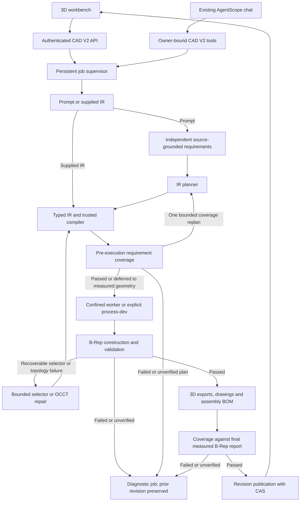

# Agent-CAD V2 architecture

V2 adds precise single-part and assembly modeling while retaining the existing 2D DXF endpoints. The source of design intent is CAD IR 2.0; build123d/OpenCascade constructs the B-Rep. The V2 worker also derives engineering drawings from the validated final shape. A completed job must have passed measured geometry validation, export verification, and atomic revision publication. A successful HTTP submission, generated Python file, or visible mesh is not a completed CAD job.

## Execution paths

The worker executes a trusted interpreter over normalized operations. The Python download is a deterministic replay program containing literal IR JSON; neither the model's response nor an uploaded script is executed as Python. Meshes are derived output, not the authoritative solid.

| Layer | Actual implementation | Responsibility |
|---|---|---|
| Domain | `backend/app/domain/cad_v2/models.py`, `expressions.py`, `compiler.py`, `editing.py`, `requirements.py` | Typed features/assemblies, safe arithmetic, dependencies, normalization, atomic patches, source-backed requirement coverage and scoped edit-plan preservation checks |
| Domain ports | `domain/cad_v2/contracts.py`, `errors.py` | `CADBackend` build/export/validate/properties/topology/tessellation/cleanup contract and structured errors |
| Application | `application/services/cad_v2_service.py` | Job admission, concurrency, progress, execution, repair, immutable revisions and publication |
| Planning | `application/services/cad_v2_planner.py` | Explicit plate creation grammar, compound offline hole edits, structured creation/edit planning and clarification |
| Requirements | `application/services/cad_v2_requirements.py` | Independent extraction before model IR generation, exact user-source quotes and mandatory deterministic guards for explicit intent |
| Model adapter | `infrastructure/cad_v2/model_gateway.py` | OpenAI-compatible JSON-object requests, bounded retries/timeouts, usage and call metadata |
| Repair | `application/services/cad_v2_repair.py`, `infrastructure/cad_v2/healing.py` | Bounded selector precision repair and OCCT topology candidates with geometric invariants; original design checks remain mandatory |
| Geometry | `infrastructure/cad_v2/backend.py`, `validation.py` | build123d/OCP solids, semantic topology selection, actual geometric checks and STEP roundtrip |
| Assembly | `infrastructure/cad_v2/assembly.py` | Reusable part definitions, located instances, datum mate/volumetric collision checks, hierarchical STEP/GLB and BOM |
| Drawing | `infrastructure/cad_v2/drawings.py` | Final B-Rep front/top/right projections, measured dimensions, DXF and SVG |
| Execution | `infrastructure/cad_v2/executor.py`, `worker.py`, `sandbox.py` | Separate process, strict Landlock/seccomp policy or explicit development mode, resource limits, cancellation and cleanup |
| Persistence | `infrastructure/cad_v2/store.py` | SQLite documents/revisions/jobs/events, owner filters, supervisor lock and CAS |
| HTTP | `interfaces/api/cad_v2_routes.py` | Request contracts, owner-bound access, SSE and revision-specific downloads |
| Local entry point | `interfaces/cad_v2_app.py` | Standalone bearer-authenticated CAD server, optional built SPA, no Mongo/Redis/browser dependency |
| Chat bridge | `domain/services/tools/cad_v2.py`, `flows/agentscope_flow.py` | Four owner-bound tools using the same lazily acquired service as HTTP |
| Frontend | `frontend/src/pages/CADV2Page.vue`, `frontend/src/components/CAD3DViewer.vue`, `frontend/src/components/CAD2DViewer.vue`, `frontend/src/api/cadV2.ts` | 3D/drawing views, component selection/visibility/translation, parameters, clarification, job events and revision-bound downloads |

Paths in the table after the first backend row are relative to `backend/app/` unless they start with `frontend/`.

## Compatibility boundary

| Concern | Existing 2D path | V2 3D path |
|---|---|---|
| API | `/api/v1/cad/*` | `/api/v1/cad-v2/*` |
| Design model | `MechanicalCADDocument`, drawing entities | `CADDocumentIR`, ordered features, optional part definitions and instances |
| Geometry | ezdxf lines, arcs, circles, annotations | Exact build123d/OCP B-Rep |
| Persistence | Existing in-process CAD document behavior | Durable jobs and immutable revisions in SQLite |
| Export | DXF | STEP, STL, GLB, IR, Python, derived DXF/SVG; assembly BOM JSON/CSV |
| Execution | Existing workbench and CAD tools | Trusted IR interpreter behind strict confinement or explicitly selected development isolation |
| Chat tools | `cad_analyze_request`, `cad_generate_dxf*`, `cad_validate_dxf` | `cad_v2_generate`, `cad_v2_job_status`, `cad_v2_edit`, `cad_v2_revision` |

The V2 tools do not accept a user/owner argument from the model. The authenticated chat flow binds that identity when constructing the toolkit; every job/revision lookup uses it. The system prompt routes 3D/STEP work to V2 and standalone 2D/DXF work to the existing tools. V2 engineering drawings are revision artifacts derived from its 3D shape. Submission tools explicitly report pending work. Legacy chat still initializes its existing sandbox/browser infrastructure; adding CAD V2 tools does not remove that dependency. The standalone CAD workbench can run without it.

There is no automatic conversion of existing 2D documents or arbitrary DXF files into constrained 3D IR. A new solid needs explicit thickness, modeling intent and feature constraints.

## IR and planning

`CADDocumentIR` version `2.0` records units, a right-handed Z-up coordinate system, parameters, features, input references, dependencies, constraints, expected geometry, optional assembly, and metadata. Parameter expressions are bounded arithmetic, not Python evaluation. The compiler rejects missing references, duplicate IDs, invalid feature order, cycles, zero directions, illegal geometry parameters, excessive patterns and non-finite values. Assembly definitions add stable part/instance/mate identities and explicit transforms. See [CAD IR specification](cad-ir-spec.md).

All coordinates in a document use one of `mm`, `cm`, `m`, or `inch`; normalization produces millimetres and degree angles for the adapter. The deterministic plate parser converts explicit measurements and clarification answers to a common unit, preserving the original default for unitless answers. Explicit IR supports conversion from its one declared document unit. Parameter `kind` controls conversion and integer validation, but the expression evaluator does not implement general dimensional algebra; it cannot prove that arbitrary angle/length expressions are physically compatible.

Offline prompt parsing is intentionally narrow: explicitly dimensioned rectangular plates and the supported centred four-through-hole pattern. It consumes the supported sentence grammar, rather than dropping unrecognized features. Complex shapes require supplied IR or a configured model. The model returns JSON, which must still pass the same local schema and compiler. A model name or key being configured does not establish that a particular provider supports the request format. A live `gpt-6.1-sol` spot check now covers one design through publication and independent STEP checks; the exact failures and follow-up evidence are recorded below. This does not establish a general model success rate.

Natural-language creation independently extracts a bounded requirement set before the structured IR planner sees the request. Each extracted obligation quotes the original request or a user answer exactly; the extractor does not see generated IR. Deterministic guards retain explicitly stated body dimensions, hole counts, hole measurements and requested typed features, even if the extractor omits them. A supported offline plate uses deterministic extraction without a model call. Missing information pauses for clarification; a complete request proceeds immediately.

Requirement coverage examines the compiled feature graph reachable from the final output and its resolved parameters. A structured plan that misses a verifiable obligation may receive one additional planning call containing the same source-backed requirements and coverage failures. Plan-stage `unverified` obligations do not trigger repeated attempts to invent evidence. The service gates every execution attempt and gates publication again using the measured final B-Rep report; overall body envelopes that cannot be proven from the primitive plan remain pending until that measurement. Kernel feature/hole validation and STEP reimport checks remain mandatory.

Coverage is deliberately conservative. A generic Box labelled "rib" or a Cut labelled "slot" does not certify Rib/Slot intent. Supplied feature types or semantic targets without a verifier remain unsupported or `unverified`, and no revision is published. Native Sweep, Loft, BSpline/path and HelicalThread operations support their typed construction, but a valid solid alone does not prove arbitrary functional descriptions, path/profile requirements or manufacturing suitability. Some requirements are checked against typed parameters and then protected by real kernel validation, rather than a general semantic inference engine.

Trusted evidence lives in immutable revision `report.requirements` and `report.requirement_coverage`, not uploaded IR metadata. The service strips `metadata.requirements` and `metadata.requirement_coverage` before execution/export. A supplied-IR job cannot create natural-language proof by forging those keys. Restore reuses a source revision's trusted report when requirements exist and rechecks it on the rebuilt solid; older or IR-only revisions have no invented requirement evidence. Edits retain the existing atomic `EditPlan` preservation checks and do not run the independent creation requirement extractor.

Editing operates on the current revision instead of requesting a replacement document. The offline editor handles supported compound mounting-plate requests for hole subsets, diameter changes, movement, removal and a central through-hole. Other requests use a typed `EditPlan` from the configured editor model. Each intent quotes request text and identifies affected features, parameters, instances and mates. Preservation checks reject undeclared changes, shared-parameter side effects, unrelated hole changes and weakened expectations before the kernel runs. Assembly instance changes use incremental patches; changing a mate requires explicit intent. Ambiguous requests raise `RequirementError` and pause as `awaiting_input`; `clarification_job_id` links an answer to the same owner/document/base revision and combines the original request and all prior answers into a new job.

For plate creation, an explicit count answer resolves an original or cross-turn four-versus-five-hole contradiction without discarding dimensions, diameter, placement or prior answers. A bare "4" is accepted only when the question uniquely asks for hole count; a grouped count-and-thickness question cannot bind that answer silently. Contradictory answers keep asking, and a non-four final count goes to structured planning with the full original request and answer history. Questions survive refresh and application restart; thickness and pitch can be supplied over separate turns.

The gateway reads `CAD_V2_API_BASE`, `CAD_V2_API_KEY`, `CAD_V2_MODEL` and optional role-specific model selection such as `CAD_V2_PLANNER_MODEL` and `CAD_V2_REQUIREMENTS_MODEL`, with existing `API_BASE`, `API_KEY`, `MODEL_NAME` fallbacks. Request timeout and retries are bounded. It logs role, model, attempts, elapsed time and supplied usage counts, not authorization headers or provider error bodies. Planner metadata preserves actual provider usage when available. Structured natural-language creation calls the independent requirements role and the planner, with at most one coverage replan. Deterministic plates avoid those calls; repair remains a trusted local policy, and no separate vision workflow is implemented.

## Live provider spot check

Three actual model calls exercised a single plate-with-boss-and-through-bore design. The original outcomes remain in the evidence; development fixes and offline rechecks are not counted as new successful model calls.

| Evidence | Actual result |
|---|---|
| [01 — first call](../../backend/benchmarks/cad_v2/live/01-first-model-attempt.json) | Failed compilation because the returned IR referenced `pi` before the compiler supported that constant |
| [02 — second call](../../backend/benchmarks/cad_v2/live/02-second-model-attempt.json) | Produced IR; validation blocked publication because a `solid_count` constraint naming the final output was not yet supported |
| [03 — unchanged IR replay](../../backend/benchmarks/cad_v2/live/03-unchanged-ir-replay.json) | The original second-call IR passed after fixing final-output constraint handling, without another model call |
| [04 — third call and service workflow](../../backend/benchmarks/cad_v2/live/04-final-live-workflow.json) | Model: 35.995 s, reported 19,943 tokens; total run: 41.591 s. The service completed and published all five artifacts, but the independent acceptance runner then raised an `AttributeError` on an empty boolean intersection represented by `None` |
| [05 — independent STEP recheck](../../backend/benchmarks/cad_v2/live/05-independent-step-recheck.json) | After correcting only that checking script, the same published STEP passed 9/9 independent checks. No geometry rebuild and no new model call were used |

Record 04 deliberately retains its outer runner failure even though its nested job and geometry report completed; record 05 supplies the corrected independent verification of that published revision. This demonstrates one design's live planning-to-artifact path and exposes two implementation defects that were fixed. It is neither a multi-design model benchmark nor an estimate of unattended reliability. Deterministic CI remains independent of paid model access. Browser acceptance is reported separately in [final report](final-report.md).

These records remain the original creation-path history. A later successful `gpt-6.1-sol` incremental-edit spot check is documented separately in the [extension report](extension-report.md). That check covers one edit case and does not establish a model success rate; it does not replace or reclassify the original calls above.

## Jobs and process boundary

Job states are `created`, `queued`, `running`, `validating`, `repairing`, `awaiting_input`, `completed`, `failed`, `cancelled`. Durable snapshots also contain the real stage (`parsing`, `planning`, `clarification`, `building`, `validating`, `exporting`, `publishing`), progress, diagnostic report, repair history and revision ID. Progress percentages indicate stages, not a measured remaining-time estimate.

The service provides bounded queue admission and concurrency. A stable job ID persists across attempts; optional request IDs deduplicate equivalent submissions within owner and operation scope and reject reuse with different content. On restart, queued jobs can resume and `awaiting_input` questions remain answerable without consuming a worker; work interrupted while actively running is marked failed, because its process and completion cannot be assumed to survive. Temporary job directories are cleaned. A completed or cancelled job cannot later be published again.

Every geometry attempt gets a dedicated process and output directory. The executor passes only a small environment allowlist, excluding model API credentials and proxy settings. The worker limits CPU time, address space, file size and file descriptors, while the parent enforces wall time and kills the process group on cancellation or timeout. No shell is used to interpret model content.

The default `CAD_V2_ISOLATION=strict` adds an unprivileged Linux confinement launcher. It requires Landlock ABI 3 or newer and libseccomp, sets `no_new_privs`, drops capabilities, installs a default-deny syscall policy, and restricts filesystem content access to read-only interpreter/dependency/application paths plus the private writable job directory. Socket creation, executable launch, cross-process operations and other unlisted system calls are denied. This uses Landlock and seccomp rather than filesystem/network namespaces; it is not a facility for running arbitrary uploaded Python and does not claim to hide filesystem metadata or eliminate side channels.

If any strict prerequisite or policy setup fails, the launcher exits before running the worker; the executor reports `IsolationUnavailableError` and does not silently fall back. `CAD_V2_ISOLATION=process-dev` is an explicit development opt-out retaining process/resource limits but unrestricted host filesystem and network access under the worker identity. Reports record the requested/actual mode and `os_enforced`; the workbench displays that status.

Strict geometry workers require a Linux runtime with the documented process/resource and syscall support, including when hosted by Docker Desktop on Windows. Native Windows does not provide this confinement policy. Check the runtime isolation probe and each job's recorded mode before treating its execution as OS-enforced.

## Validation and repair

The validator examines the executed solid: validity, positive finite volume, solid count, finite bounds, requested dimensions and volumes, supported hole profiles/positions/diameters/through-clearance or blind depth, and measurable fillet/chamfer material and topology changes. Finish checks also measure supported fillet cylinder/torus radii or planar chamfer-to-original-edge distances and verify those geometric surface signatures remain in the final solid. Post-transform finish matching remains `unverified`. Supported boolean operations reject empty results or ineffective cuts. The exporter writes STEP, reimports it, and compares validity, volume, bounds and solid count. Preview metadata accounts for GLB metre/Y-up presentation versus IR millimetre/Z-up modeling.

Final-output dimension, volume and solid-count constraints are supported both without a `feature_id` and when it explicitly equals the output feature. Each check records expected/actual values, tolerance, status and evidence. Unsupported design constraints are `unverified`, not passed. The worker refuses to publish when any check fails or remains unverified. This conservatism means some buildable complex designs require more supported final-frame constraints or additional geometric verifiers. [Geometry validation](geometry-validation.md) lists exact coverage and limitations.

Automatic repair has two bounded paths. A reproducible unique semantic edge selection failing because of overly strict precision in millimetre documents can receive a narrowly increased selector tolerance, preserving dimensions, hole count, required radius, expected match count and all validation expectations. A recoverable topology failure with a surviving candidate shape can instead trigger trusted execution policies for OCCT `shape_fix`, `orient_solids`, or `sew_closed_shells`. These topology policies leave the IR unchanged, operate on a copy, and check bounds, absolute volume, existing solid count and face geometry including inner loops and supported analytic surface parameters. They can recover suitable tolerance defects, reversed solid orientation or a sewable closed face set; they do not guarantee recovery of arbitrary topology.

The backend applies a targeted policy after the identified feature operation, records before/after evidence in its trace, and reruns original design validation and actual export/reimport checks. The service retains the candidate policy, exact patch, reason and fingerprint in repair history and prevents identical retries. The default repair budget is three; the configurable budget and local policy have a hard maximum of five attempts. Generic kernel exceptions without a candidate shape, infrastructure failures, invalid dimensions and unsupported/unverified constraints do not become successful geometry repairs.

## Assemblies and derived drawings

An assembly references reusable single-solid part definitions from the feature graph and creates separately located instances with stable IDs, display names, colors and optional material labels. It is not a fused multi-body pattern. Global mass/bounds and local part expectations are measured independently. Supported `fixed`, `aligned`, and `concentric` mates check explicit relative datum frames and poses; they do not solve or move components. When enabled, collision validation measures exact Boolean common volume for every pair of world-placed component solids. Touching faces are allowed within the declared volume tolerance. The report records whether collision checking was enabled.

STEP and GLB preserve named component hierarchy; STEP reimport verifies individual component identity, geometry and placement as well as aggregate geometry. GLB nodes use stable instance IDs and carry part/display metadata, with node poses checked against the component placements. Assembly exports also contain a JSON manifest/BOM and CSV quantities. A repeated part remains multiple independent occurrences, and the BOM groups their IDs under the part definition.

The worker sends the same validated final B-Rep to the drawing exporter. OpenCascade hidden-line projection produces front/top/right views in third-angle layout. Analytic shapes use exact B-Rep HLR and DXF preserves supported analytic curves and NURBS. Shapes containing BSpline/Bezier faces use native polygonal HLR on a freshly generated mesh from the final B-Rep, with a 0.01 mm linear deflection target, 0.15 rad angular deflection and a 100000-triangle limit; their DXF geometry is approximate line segments. Reports expose `method=occt_polygonal_hlr`, `projection_mode=bounded_tessellation` and the approximation tolerance; DXF/SVG also display a visible projection note. SVG uses that same projection. Dimensions still come from measured exact final bounds and supported complete cylindrical hole geometry, rather than unverified IR annotations. Coverage does not include arbitrary manufacturing tolerances, fits or general dimensioning of every feature. Drawing evidence is stored in the revision report, and DXF/SVG downloads are tied to that revision. This does not add arbitrary DXF-to-3D reconstruction or change the existing standalone 2D document model.

## Persistence and revision publication

V2 uses one local SQLite database in WAL mode because the current service does not need another external queue to execute bounded local jobs. The existing chat task infrastructure depends on Redis and in-process registries, and is not reused as though it were a durable CAD queue. V2 stores documents, immutable revisions, jobs and SSE events together; exported files reside under the same configured data root.

`CAD_V2_DATA_DIR` contains `cad.sqlite3`, SQLite auxiliary files, `supervisor.lock`, temporary `jobs/`, and `artifacts/<document-id>/<revision-id>/`. Artifact records include format, filename, SHA-256 and size. The publication contract requires STEP, STL, GLB, IR and Python; the current worker additionally produces DXF/SVG and, for assemblies, BOM JSON/CSV. Older revisions retain their original manifests. Artifact directories are recorded with absolute paths, so restores must preserve the service-visible data-root path unless a deliberate path migration is implemented.

A nonblocking process lock (`fcntl` on Linux, `msvcrt` on Windows) permits exactly one active supervisor per data directory. Run **one API worker** and keep SQLite on local persistent storage. Horizontal replicas, multiple supervisors and SQLite over NFS are not supported. Queue state is durable; this is not a distributed worker system. Geometry worker isolation still requires the documented Linux/Docker environment.

Editing uses `expected_revision` as a compare-and-swap precondition. After rebuild and validation, publication starts a SQLite transaction and rechecks the document still points to that base revision and that the job is active. Only then are the immutable revision, current pointer and completed snapshot committed. If another edit won, the result is rejected and unpublished artifacts are removed. A failed edit never replaces the last valid revision.

Parameter patches preserve shared expressions. Feature patches can update params and explicit dependencies/inputs; additions or deletions may require an explicit `output_feature` switch. User-authorized design changes can supply a partial `expected_geometry` patch and a complete replacement `constraints` list. Unspecified expectations remain unchanged. This supports adding/deleting material features while recording the revised engineering intent; automatic repair does not use this escape to weaken checks. Restore rebuilds an old IR into a new revision instead of erasing history.

Assembly edits add `instance_patches`, `add_instances`, `delete_instances`, and `mate_patches`. Existing IDs and editability are protected, partial transforms retain their unspecified field, and dangling part or mate references reject the edit. An explicit instance-count change updates the matching aggregate solid count unless the request supplies its own count; other expectations remain checked. The revision diff includes assembly changes. See the [IR specification](cad-ir-spec.md) for exact patch fields and [HTTP API](api-v2.md) for request shapes and clarification rules.

## HTTP contracts

All paths below have prefix `/api/v1/cad-v2`. Successful JSON responses use the existing `{code: 0, msg: "success", data: ...}` envelope. Creation/edit/restore return HTTP 202 and a job snapshot. Authentication applies to jobs, events, documents, revisions and artifacts; owner mismatches return a not-found result.

| Method and path | Behavior |
|---|---|
| `POST /jobs` | Exactly one `prompt` or `ir`; optional `name`, `request_id`; initial-generation answers use `prompt` plus `clarification_job_id` |
| `GET /jobs/{job}` | Current durable status/report |
| `POST /jobs/{job}/cancel` | Cancel pending/running work; preserve published model |
| `GET /jobs/{job}/events` | SSE `job` snapshots with persistent event IDs; resume via `after` or `Last-Event-ID` |
| `GET /documents` | Owner's documents |
| `GET /documents/{document}` | Document and current revision pointer |
| `GET /documents/{document}/revisions` | Immutable history |
| `GET /documents/{document}/revisions/{revision}` | IR, report, diff and artifact manifest for one revision |
| `POST /documents/{document}/edits` | `expected_revision` plus explicit parameter/feature/instance/mate patches or an edit prompt; optional `clarification_job_id` |
| `POST /documents/{document}/restore` | `revision_id` to restore plus current `expected_revision`; creates a new revision |
| `GET /documents/{document}/revisions/{revision}/artifacts/{format}` | Manifest-backed `step`, `stl`, `glb`, `ir`, `python`, `dxf`, `svg`, `bom_json`, `bom_csv`; authenticated file, ETag and `X-CAD-Revision` |

HTTP schemas reject extra fields and non-finite numeric inputs; request-size middleware bounds V2 JSON requests without changing legacy multipart file upload behavior. Downloads resolve only known manifest files beneath the owned revision directory. Preview and download selection use explicit revision IDs, never a moving “latest” path.

The workbench at `/chat/cad-v2` supports `?document=<id>&revision=<id>` for exact historical views. Parameter changes and explicit component translation edits request a real backend rebuild; camera movement and component visibility affect viewing only. The 3D and engineering drawing views use the selected revision. Assembly selection maps GLB component nodes to stable instance IDs, while single-part highlighting does not create an editable topological index. SSE displays actual service stages, and authenticated requests load GLB, drawings and downloads. Initial generation and edits can end in `awaiting_input` with targeted missing-information questions. The answer form submits a new job against the same document with durable original requirements and all prior answers. Waiting jobs terminate SSE without consuming a worker, survive restart, and remain in the page URL for refresh recovery. Configuration/build failures retain `failed` status. The UI also displays recorded execution isolation.

## Deployment and evidence boundary

The integrated `app.main:app` retains Mongo/Redis/auth/chat startup and adds the V2 service. The standalone `app.interfaces.cad_v2_app:app` uses a private bearer token of at least 16 characters, exposes the same V2 router, and can serve a built frontend. Login uses `local@localhost` with that private token as the password; compatible login, refresh and logout endpoints support the existing frontend. This fixed token represents one local user and is revoked by rotating the configured token, not by client logout. It is not a multi-user account-management replacement.

The standalone dependency lock is `backend/requirements-cad-v2.txt`; container entry points are `backend/Dockerfile.cad-v2` and `docker-compose.cad-v2.yml`. These describe standalone CAD plus frontend, not the entire original service stack. CI configuration is `.github/workflows/cad-v2.yml`. See [migration guide](migration-guide.md) and the project README for setup.

The original implementation recorded a full backend dependency installation with `uv sync --locked --no-dev` and an integrated application/OpenAPI import with 58 registered paths, including 11 CAD V2 paths. These historical checks establish dependency resolution and route registration, not a running Mongo/Redis/chat stack or verification of all subsequent changes. The [final report](final-report.md) preserves that evidence and its limitations; the [extension report](extension-report.md) records the later editing, assembly, repair, drawing and confinement work.

Standalone CAD validation covers its own API, persistence and isolated geometry workflow. Verify cloud CI, the complete Mongo/Redis/chat deployment and browser interaction separately; standalone checks do not establish acceptance of those environments. Keep `process-dev` results distinct from strict confinement evidence.
